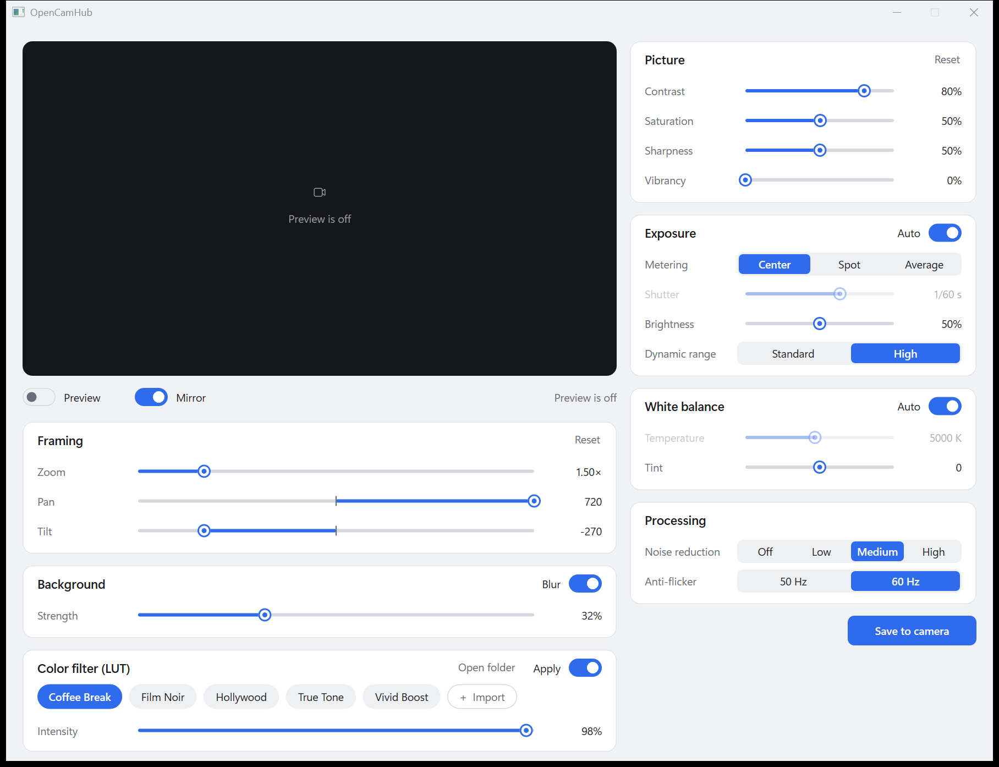

# OpenCamHub

**An open-source, local-only alternative to Elgato Camera Hub for the Elgato Facecam MK.2 on Windows 11.**

OpenCamHub gives you the Facecam MK.2's picture controls, colour LUTs, digital zoom and framing,
mirroring and GPU background blur in a small native app with no account, telemetry, cloud
connection or background updater. It appears to Windows as a camera called **OpenCamHub**, which you
pick in Zoom, Teams, Meet, OBS, Discord or your browser.



> OpenCamHub is an independent project. It is not affiliated with, endorsed by or supported by
> Elgato, Corsair or Microsoft. "Elgato", "Facecam" and "Camera Hub" are trademarks of their owners.

## Features

- **All of the camera's own controls**: contrast, saturation, sharpness, vibrancy, exposure (auto,
  shutter, metering, brightness), dynamic range (HDR), white balance (auto, temperature, tint), noise
  reduction and anti-flicker, plus **Save to camera** so the settings stay on the camera itself.
- **Framing**: zoom, pan and tilt.
- **Colour filters**: any `.cube` 3D LUT, with an intensity slider. If Camera Hub's LUTs are on the
  PC, the installer copies them across so you can keep using them.
- **Background blur**: [Robust Video Matting](https://github.com/PeterL1n/RobustVideoMatting) running
  on your GPU through DirectML (any DirectX 12 GPU, so NVIDIA, AMD and Intel). It takes about 7 ms
  a frame on an RTX-class card and keeps 1080p60.
- **Mirror** the image.
- **Live preview** in the settings window, even while another app is using the camera.
- **Light and dark** themes that follow Windows, with sharp rendering at any display scale.
- The effects run inside Windows' own camera service, so they apply in every app and keep working
  after you close the settings window.

## Privacy

- No network code. OpenCamHub never connects to the internet; neither the app nor the virtual camera
  links any networking library.
- ONNX Runtime's telemetry is switched off in code (`DisableTelemetryEvents`), and the build turns
  off the Visual Studio build tools' telemetry.
- The only downloads happen when you **build** it: `scripts/fetch-deps.ps1` fetches three pinned
  files and checks each against a SHA-256 hash.
- Settings are kept in a plain text file, `%ProgramData%\OpenCamHub\settings.ini`.

## Requirements

- Windows 11 (the virtual camera uses `MFCreateVirtualCamera`, added in Windows 11).
- An Elgato Facecam MK.2 (USB `VID_0FD9&PID_0094`).
- For background blur: a DirectX 12 GPU. It also runs on the CPU, but slowly.
- To build: [Visual Studio Build Tools](https://visualstudio.microsoft.com/visual-cpp-build-tools/)
  with the "Desktop development with C++" workload and a Windows 11 SDK.

You don't need Camera Hub. If it is installed, stop it from starting with Windows so the two don't
fight over the camera settings.

## Build and install

From a PowerShell prompt in the repository:

```powershell
.\build.ps1
```

The first build runs `scripts\fetch-deps.ps1`, which downloads about 330 MB into `third_party\`:
ONNX Runtime 1.24.4 with DirectML, DirectML 1.15.4 and the RVM ResNet50 model. The output goes to
`out\`.

Then install from an **administrator** PowerShell prompt:

```powershell
powershell -ExecutionPolicy Bypass -File .\install.ps1
```

The installer copies the files to `%ProgramFiles%\OpenCamHub`, registers the virtual camera, creates
`%ProgramData%\OpenCamHub` for settings and LUTs, and adds **OpenCamHub** to the Start menu. Run it
again after a rebuild to update. Pass `-LutSource <folder>` to import your own `.cube` files.

To remove it (add `-RemoveSettings` to delete your settings and LUTs too):

```powershell
powershell -ExecutionPolicy Bypass -File .\uninstall.ps1
```

## Using it

1. Open **OpenCamHub** from the Start menu to adjust the picture. Changes apply immediately.
2. In your video app, choose the camera named **OpenCamHub** rather than "Elgato Facecam MK.2".
3. Close the window when you're done. The settings stay in effect; there is nothing running in the
   background apart from Windows' own camera service while an app uses the camera.

## How it works

```
Facecam MK.2 ──► Windows Frame Server ──► vcam.dll (OpenCamHub virtual camera) ──► your app
                                           mirror → background blur → LUT
OpenCamHub.exe ── camera controls (UVC + Elgato extension units) ──► Facecam MK.2
               └─ writes settings.ini, which vcam.dll re-reads twice a second
```

- `src/vcam`: the virtual camera, a Media Foundation media source that Windows' Frame Server loads.
  It wraps the real Facecam and edits each NV12 frame in place.
- `src/common`: the frame effects: LUT tables, RVM matting through the ONNX Runtime C API, and a
  masked background blur that runs on a 1/8-size copy and is blended back at full resolution.
- `src/app`: the settings window (Win32 + Direct2D). It drives the camera's standard UVC controls
  through DirectShow and Elgato's vendor controls through `IKsControl` extension-unit requests.
- `src/tools/opencamhub-setup.cpp`: registers the camera, and has commands for listing formats,
  grabbing frames and benchmarking (`opencamhub-setup` with no arguments shows them).

## Licence

OpenCamHub is free software under the [GNU General Public License v3.0](LICENSE). Third-party
components and their licences are listed in [THIRD_PARTY_NOTICES.md](THIRD_PARTY_NOTICES.md).
